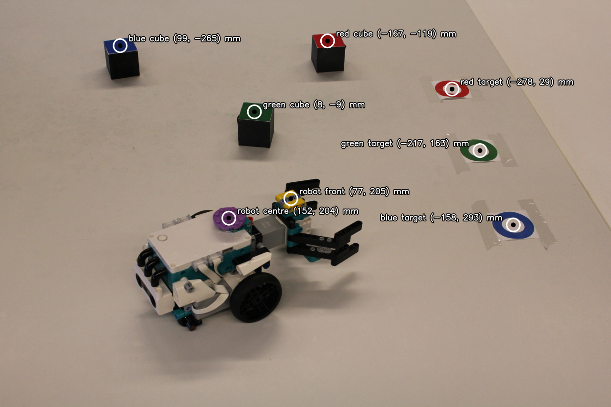

# 3D Computer Vision: Practical assignment
Project work repository for the practical assignment for the course "3D Computer Vision". Goal of the project is to build a workflow for guiding a robot to move colored cubes to the desired target. The workflow includes camera calibration, object detection and an algorithm for guiding the robot. No deep learning methods were used for the solution.

**Context:** 3D Computer Vision, LUT University, spring 2026. Team project.



*Output on `img/test.png`: each detected element is labelled with its estimated position on the floor plane (X, Y in mm, world frame defined by the calibration chessboard).*

## Approach
1. **Camera calibration and projection matrix** (`calibration.py`). The 6×8 inner corners of a chessboard with 40 mm squares are detected in the calibration image, along with the top-face corners of the blue and green cubes (Z = 80 mm and Z = 40 mm). This gives non-coplanar 2D–3D correspondences. The 3×4 projection matrix is estimated with the direct linear transform (DLT) and solved with SVD, with Hartley-style normalisation of the 2D and 3D points. Points can also be selected by hand (`mode="manual"`).
2. **Colour-based cube detection** (`image_processing.py`, `image_analysis.py`). The image is thresholded in HSV space for red, green, blue, yellow and purple, then cleaned with morphological opening and closing. The two largest blobs of each colour are kept. A cube's top face is told apart from its ring-shaped target by whether the mask is filled at the blob centroid. The robot's centre is the purple marker, and its front is the yellow marker (refined using the blue dots inside it).
3. **Height estimation** (`elements.py`, `calibration.py`). Each element type has a known height above the floor: cube top face 40 mm, targets 0 mm, robot front 85 mm, robot centre 90 mm. A detected image point is back-projected through the projection matrix onto the horizontal plane at that height, which gives its world X, Y position.
4. **Robot instructions** (`execute.py`). From the world positions of the cubes, the targets and the robot's centre and heading, distances and turn angles are computed. These are written out as a command string of `turn(angle)`, `go(distance)`, `grab()` and `let_go()` steps.

## How to run
Requires Python 3 (tested with Python 3.12, OpenCV 4.11, NumPy 2.0 and Matplotlib 3.9).

```bash
pip install -r requirements.txt
python assignment.py
```

This calibrates the camera from `img/calibration.png` and prints the robot instructions for `img/test.png`. The pipeline is tuned for the full-resolution 5184×3456 images in `img/`.

## Usage
In `assignment.py`, functions `calibrate_camera()` and `move_block()` are defined. Define paths to the calibration image and the test image as well as the array of block you want to move, then use the functions mentioned to calibrate the camera (calculate projection matrix) and get instructions for the robot. Function `main()` displays an example workflow.

You can also import the functions to be used in other code files by writing `from assignment import calibrate_camera, move_block` to the beginning of a `.py` file.
